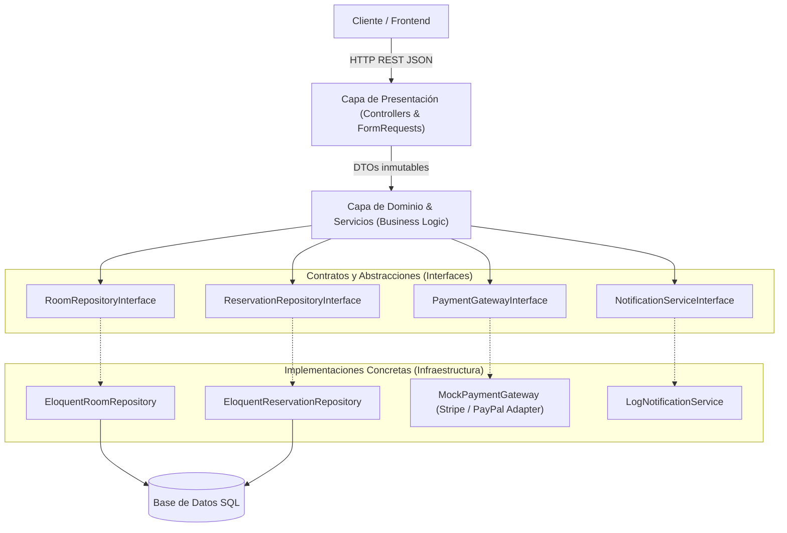
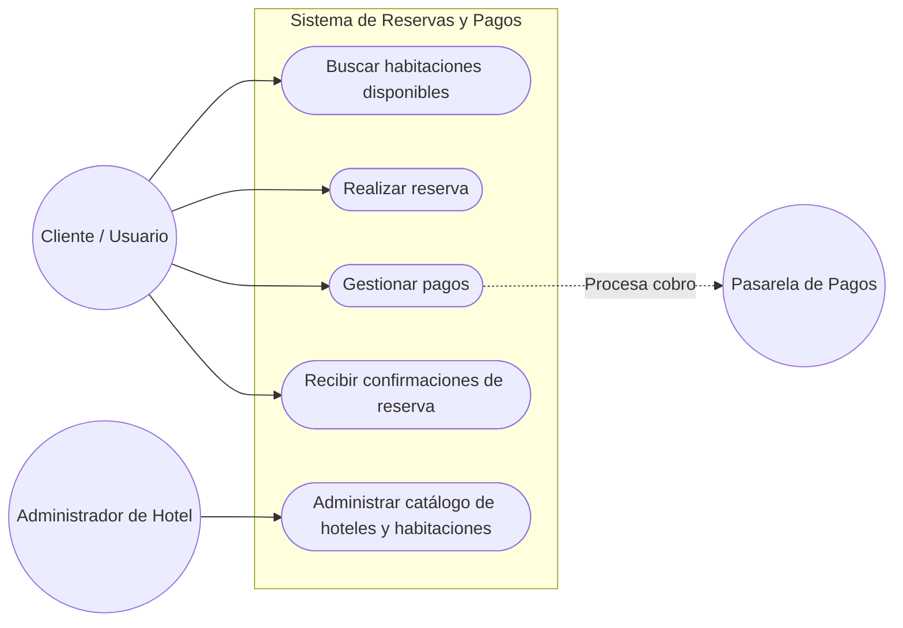
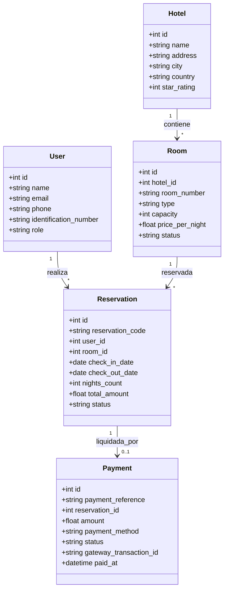
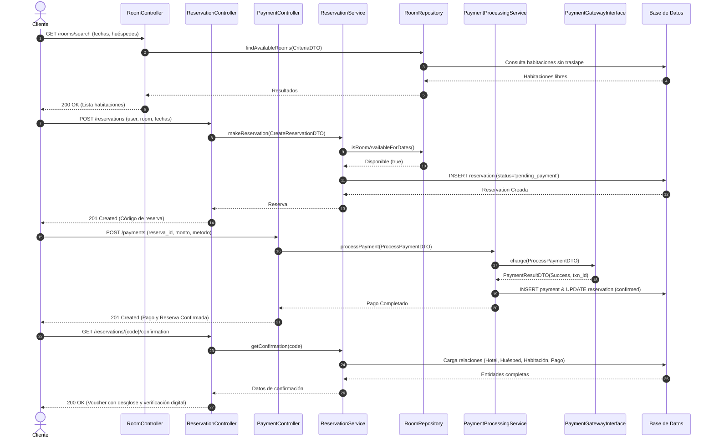

# Arquitectura y Diseño del Sistema de Reservas de Hotel

> **Competencia**: Desarrollar competencias en el modelado colaborativo de arquitecturas de software mediante UML, enfocándose en la correcta definición de contratos de API y la aplicación de principios de desacoplamiento en sistemas empresariales.

---

## 1. Visión General de la Arquitectura

Para satisfacer las demandas de un entorno empresarial escalable, mantenible y testeable, se diseñó una **Arquitectura en Capas (Layered Clean Architecture)** que respeta los principios **SOLID**, especialmente el **Principio de Inversión de Dependencias (DIP)**.

---

## 2. Principios de Desacoplamiento Aplicados

### A. Definición de Contratos de API (API Contracts)
- **Especificación OpenAPI 3.0**: La comunicación entre clientes y el backend se rige por un contrato explícito (`docs/openapi.yaml`), eliminando ambigüedades sobre tipos de datos, códigos HTTP (`200 OK`, `201 Created`, `422 Unprocessable Content`, `404 Not Found`) y estructuras de entrada/salida.
- **Form Requests**: La validación no se mezcla con la lógica de negocio; cada endpoint tiene un FormRequest especializado (`SearchRoomsRequest`, `StoreReservationRequest`, `ProcessPaymentRequest`).
- **API Resources**: Desacoplan la estructura de la base de datos de lo que el cliente consume en JSON. Si una columna cambia de nombre en la BD, el contrato público permanece inalterado.

### B. Inversión de Dependencias (DIP) y Contenedor IoC
- Las capas de alto nivel (`ReservationService`, `PaymentProcessingService`) **no dependen de implementaciones de bajo nivel** (como Eloquent o librerías de SDK de Stripe). Dependen exclusivamente de **interfaces (contratos)** ubicados en `app/Contracts/`.
- El enlace se realiza a través de `HotelReservationServiceProvider` en el Service Container de Laravel.

### C. Patrón Adapter / Gateway para Pagos
- El procesamiento de pagos implementa `PaymentGatewayInterface`.
- Permite cambiar de pasarela (Stripe, PayPal, MercadoPago o Mock) sin alterar una sola línea de código en la lógica de reservas.

### D. Data Transfer Objects (DTOs)
- La comunicación entre controladores y servicios se realiza mediante DTOs inmutables fuertemente tipados en PHP 8.2+ (`RoomSearchCriteriaDTO`, `CreateReservationDTO`, `ProcessPaymentDTO`, `PaymentResultDTO`).
- Evita que los servicios dependan del objeto HTTP `$request`.

---

## 3. Diagramas UML

### 3.1 Diagrama de Casos de Uso

### 3.2 Diagrama de Clases del Dominio y Arquitectura

### 3.3 Diagrama de Secuencia: Reserva, Pago Desacoplado y Confirmación

---

## 4. Matriz de Endpoints y Casos de Uso

| Caso de Uso | Método HTTP | Endpoint | Contrato Request | Contrato Response |
| :--- | :--- | :--- | :--- | :--- |
| **Buscar habitaciones disponibles** | `GET` | `/api/v1/rooms/search` | Query params: `check_in_date`, `check_out_date`, `guests`, `hotel_id` | `200 OK`: `RoomResource[]` |
| **Realizar reservas** | `POST` | `/api/v1/reservations` | Body JSON: `user_id`, `room_id`, `check_in_date`, `check_out_date`, `guests_count` | `201 Created`: `ReservationResource` |
| **Gestionar pagos** | `POST` | `/api/v1/payments` | Body JSON: `reservation_id`, `amount`, `payment_method`, `token` | `201 Created`: `PaymentResource` |
| **Recibir confirmaciones de reserva** | `GET` | `/api/v1/reservations/{identifier}/confirmation` | Path param: ID o `reservation_code` | `200 OK`: `ReservationConfirmationResource` |
| **Consultar catálogo de hoteles** | `GET` | `/api/v1/hotels` | N/A | `200 OK`: `HotelResource[]` |
